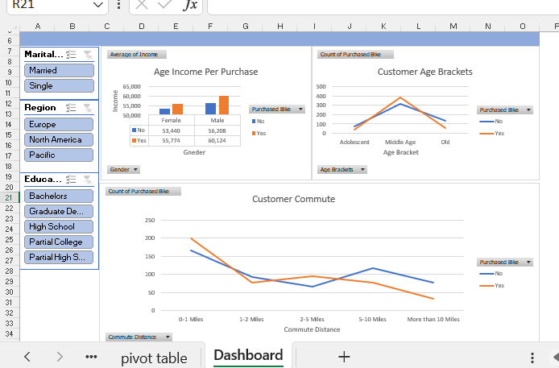

# Bike Buyers Dashboard (Excel)

An interactive Excel dashboard that explores which customers are most likely to purchase a bike.

## Key Questions
- How does income differ between bike buyers and non-buyers, by gender?
- Which age brackets (Adolescent, Middle Age, Old) buy the most bikes?
- How does commute distance relate to bike purchases?

## Dashboard Features
- Pivot tables and pivot charts (line and column charts)
- Slicers to filter by Marital Status, Region, and Education
- Charts: Average Income by Gender, Customer Age Brackets, Customer Commute Distance

## Key Insights
- Middle-aged customers have the highest number of bike purchases.
- Customers with short commutes (0-1 miles) show the highest purchase count.
- Average income of buyers is slightly higher than non-buyers for both genders.

## Tools Used
- Microsoft Excel (Pivot Tables, Pivot Charts, Slicers)

